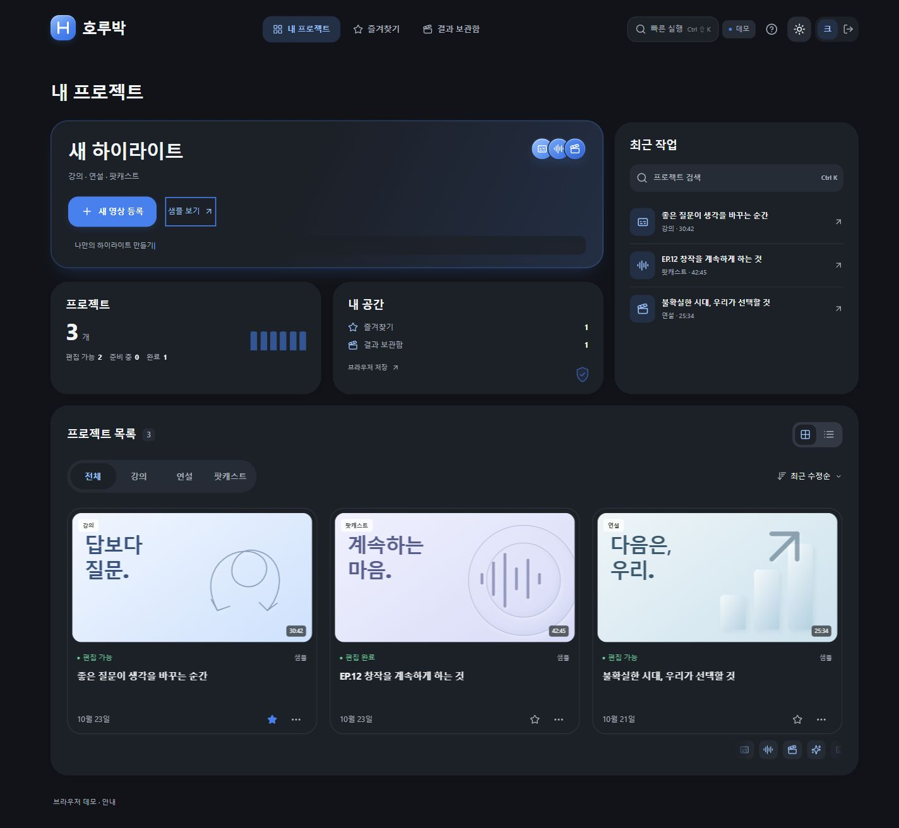

# 호루박 · 하이라이트 제작 시스템

강의·연설·팟캐스트의 하이라이트를 탐색하고 편집하는 React·TypeScript 프론트엔드입니다.

현재는 **브라우저 데모**입니다. 실제 인증·AI 분석·업로드·MP4 출력 서버는 연결 전이며, 샘플과 로컬 영상 미리보기로 화면과 편집 흐름을 확인할 수 있습니다.

## 실행

개발에 사용한 환경은 Node.js 24, pnpm 11입니다.

```powershell
npm install --global pnpm@11.25.0
cd frontend
pnpm install --frozen-lockfile
pnpm dev
```

[http://127.0.0.1:5173](http://127.0.0.1:5173)에서 **샘플로 시작**을 선택하세요. 샘플은 가입 없이 사용할 수 있습니다. 종료는 실행 터미널에서 Ctrl+C를 누릅니다.

Windows에서는 의존성을 설치한 뒤 최상위의 **사이트 실행.cmd**로 실행할 수도 있습니다. 실행 중에는 터미널 창을 열어 두세요. 5173 포트가 사용 중이면 기존 실행 창을 확인하세요.

## 구현한 화면

- 로그인·회원가입: 로컬 데모 프로필, 비밀번호 표시, 입력 오류 안내.
- 프로젝트: 214번 벤토, 최근 작업, 검색·장르·정렬, 카드/목록 보기, 즐겨찾기·이름 변경·삭제 확인.
- 빠른 실행: Ctrl/Cmd+Shift+K로 프로젝트·명령 검색. Ctrl/Cmd+K는 프로젝트 검색.
- 영상 등록: MP4/MOV 선택·드래그 앤 드롭, URL 기록, 장르와 이름 입력.
- 처리 현황: 화면 흐름을 확인하는 시뮬레이션과 취소·재시작.
- 편집: 샘플 전사·후보·맥락 비교, 원본 시간 탐색, 자막·구간·수동 크롭 조정과 되돌리기.
- 결과: 샘플 SRT 자막과 편집 JSON 다운로드.
- 라이트/다크, 모바일 배치, 키보드 조작, 모션 줄이기 대응.



## 실제 연결 여부

| 항목 | 현재 상태 |
|---|---|
| 화면·편집 상태 | 구현 |
| 프로필·프로젝트·편집 정보 | 데모 사용자별 localStorage |
| 로컬 영상 미리보기 | 브라우저 blob URL, 서버 전송 없음 |
| 로그인·가입·접근 제어 | 클라이언트 데모, 서버 인증 미연결 |
| 전사·후보·맥락 경고 | 미리 작성한 샘플 |
| 직접 등록한 영상의 AI 분석 | 미연결. 샘플 분석을 원본 분석으로 표시하지 않음 |
| 업로드·URL 수집·작업 큐·버전 DB | 팀원 API 연결 전 |
| 화자·얼굴 추적·OCR·자연어 명령 | 미연결 |
| MP4 렌더링 | 미연결 |
| SRT·편집 JSON | 브라우저에서 실제 파일 생성 |

프로필과 편집 정보는 현재 브라우저에만 저장됩니다. 브라우저 데이터를 지우면 함께 지워집니다. 영상 파일 자체는 저장하지 않으므로 새로고침 후 **원본 다시 연결**로 다시 선택해야 합니다.

데모 가입에는 실제 서비스용 비밀번호를 사용하지 마세요. 로컬 해시와 사용자 구분은 서버 인증·접근 제어를 대체하지 않습니다. 현재 UI 실행에는 OpenAI API 키가 필요하지 않습니다.

## 검증

frontend 폴더에서 실행합니다.

```powershell
pnpm test
pnpm build
```

최근 검증: TypeScript·프로덕션 빌드·단위 테스트 12개 통과. 내장 브라우저에서 테마 전환, 375px 배치, 검색·필터 복구·메뉴·키보드 동작, 로그인 중앙 정렬을 확인했습니다. 실제 터치 기기의 길게 누르기와 OS 모션 줄이기 설정을 켠 실기기 검수는 수행하지 않았습니다.

## 코드와 연동

```text
frontend/src/pages/                 화면
frontend/src/components/lucian/     Lucian 요소와 원본 CSS
frontend/src/styles/                테마·레이아웃
frontend/src/services/contracts.ts  팀원 API 인터페이스
frontend/src/project-search.ts      검색·필터 복구
frontend/src/data.ts                장르별 샘플
frontend/src/store.tsx              브라우저 데모 상태
docs/                              연동·디자인·검수 기록
```

- [팀원 API 연동 안내](docs/frontend-integration.md)
- [Lucian 사용·변경 내역](docs/lucian-elements.md)
- [UI 검수 기록](docs/ui-review.md)

Lucian 원본 CSS와 MIT 라이선스 주석을 포함합니다. 다시 다운로드하지 않아도 사이트를 실행할 수 있습니다. scripts/prepare-lucian.mjs는 로컬 다운로드 캐시에서 원본 CSS를 추출하는 제작용 도구로, 일반 실행에는 필요하지 않습니다.

node_modules, dist, .cache, .env 파일은 Git에 포함하지 않습니다.
