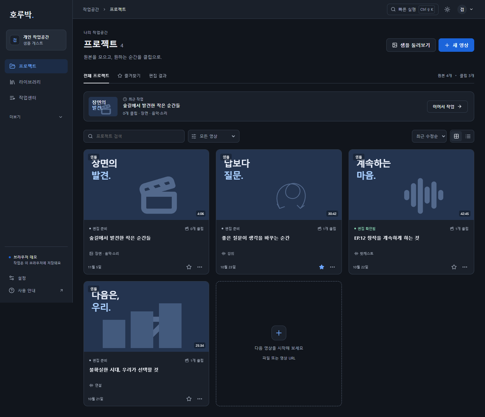

# 호루박 · 하이라이트 제작 시스템

**AI 결합 영상물 하이라이트 숏폼 자동 제작 시스템**의 React·TypeScript 프론트엔드입니다. 분야를 제한하지 않고 영상의 장면·발화·소리·화면 정보를 탐색하며 여러 클립을 편집하는 구조를 제공합니다.

현재는 **브라우저 데모**입니다. 실제 인증·AI 분석·업로드·MP4 출력 서버는 연결 전이며, 샘플과 로컬 영상 미리보기로 화면과 편집 흐름을 확인할 수 있습니다.

## 실행

개발에 사용한 환경은 Node.js 24, pnpm 11입니다.

```powershell
npm install --global pnpm@11.25.0
cd frontend
pnpm install --frozen-lockfile
pnpm --config.verify-deps-before-run=false dev
```

[http://127.0.0.1:5173](http://127.0.0.1:5173)에서 **샘플로 시작**을 선택하세요. 샘플은 가입 없이 사용할 수 있습니다. 종료는 실행 터미널에서 Ctrl+C를 누릅니다.

Windows에서는 의존성을 설치한 뒤 최상위의 **사이트 실행.cmd**로 실행할 수도 있습니다. 실행 중에는 터미널 창을 열어 두세요. 5173 포트가 사용 중이면 기존 실행 창을 확인하세요.

## 구현한 화면

- 로그인·회원가입: 로컬 데모 프로필, 비밀번호 표시, 입력 오류 안내.
- 프로젝트: 공통 사이드바, 최근 작업, 검색·콘텐츠 특성·정렬, 3열 카드/목록, 즐겨찾기·이름 변경·삭제 확인.
- 빠른 실행: Ctrl/Cmd+Shift+K로 프로젝트·명령 검색. Ctrl/Cmd+K는 프로젝트 검색.
- 영상 등록: MP4/MOV 선택·드래그 앤 드롭, URL 기록, 선택적인 제작 목적·관심 대상·영상 특성과 이름. Stageshow 정적 제작 흐름 예시.
- 프로젝트 허브: 추천 후보·내 클립·원본 탐색·작업/출력. 후보 채택·숨기기/복구, 여러 클립 생성·복제·이름 변경·삭제 확인.
- 편집: 클립별 구간·자막·구도·맥락 비교·되돌리기, 발화 또는 장면/음향 근거 탐색, 로컬 원본 재연결. 편집 길이 검증은 기존 30~60초 기준입니다.
- 결과: 선택 클립의 편집 JSON과 발화가 있는 샘플의 SRT. 무음 시각 샘플에는 가짜 전사/SRT를 만들지 않습니다.
- 라이브러리·설정: 로컬 원본 목록, 브랜드 프리셋 저장·미리보기, 편집 JSON 백업.
- 작업센터: 기존 데모 처리 상태의 취소·재시작. 새 등록에는 가짜 처리 지연을 만들지 않습니다.
- 게시·팀·성과: 후속 서버 연결을 위한 화면이며 실제 게시·협업·성과 기능은 미연결입니다.
- 라이트/다크, 키보드 조작, 모션 줄이기 대응. 데스크톱 창 너비 1280px 이상을 지원하며 작은 창에서는 가로 스크롤을 사용합니다. 모바일 전용 UI는 구현하지 않습니다.



## 실제 연결 여부

| 항목 | 현재 상태 |
|---|---|
| 화면·편집 상태 | 구현 |
| 프로필·프로젝트·여러 클립·편집 정보 | 데모 사용자별 localStorage, 기존 자료 백업·v3 이전 |
| 로컬 영상 미리보기 | 브라우저 blob URL, 서버 전송 없음 |
| 로그인·가입·접근 제어 | 클라이언트 데모, 서버 인증 미연결 |
| 전사·후보·맥락 경고 | 미리 작성한 샘플 |
| 직접 등록한 영상의 AI 분석 | 미연결. 샘플 분석을 원본 분석으로 표시하지 않음 |
| 업로드·URL 수집·작업 큐·버전 DB | 팀원 API 연결 전 |
| 화자·얼굴 추적·OCR·자연어 명령 | 미연결 |
| MP4 렌더링 | 미연결 |
| SRT·편집 JSON | 브라우저에서 실제 파일 생성 |
| Stageshow 제작 흐름 | 정적 UI 예시. 실제 분석·업로드 결과가 아님 |
| 브랜드 프리셋 | 로컬 저장·미리보기. 최종 렌더 적용은 미연결 |
| 게시·협업·성과·결제·API 연동 | 미연결. 실제 성공/사용량을 만들어 표시하지 않음 |

프로필과 편집 정보는 현재 브라우저에만 저장됩니다. 브라우저 데이터를 지우면 함께 지워집니다. 영상 파일 자체는 저장하지 않으므로 새로고침 후 **원본 다시 연결**로 다시 선택해야 합니다.

데모 가입에는 실제 서비스용 비밀번호를 사용하지 마세요. 로컬 해시와 사용자 구분은 서버 인증·접근 제어를 대체하지 않습니다. 현재 UI 실행에는 OpenAI API 키가 필요하지 않습니다.

## 검증

frontend 폴더에서 실행합니다.

```powershell
pnpm --config.verify-deps-before-run=false test
pnpm --config.verify-deps-before-run=false build
```

검증은 설치된 의존성을 그대로 사용하며 실행 전 자동 재설치를 생략합니다. 의존성이 없다면 먼저 위 설치 절차를 실행하세요.

v3 검증: 단위 테스트 38개·TypeScript·프로덕션 빌드 통과. 데이터 이전·클립 독립 편집·장면 근거·출력 규칙을 검사합니다. Stageshow 정적 장면의 라이트/다크·모션 줄이기 촬영은 --still --gate 통과이며 애니메이션 검수가 아닙니다. 데스크톱 화면 조합과 실제 조작의 실행 증거·미검증 범위는 [v3 검수 기록](docs/ui-review-v3.md)과 [화면 검수 행렬](docs/ui-v3-layout-matrix.json)을 확인하세요. v2의 21개 시험·42개 화면 조합 기록은 별도 보존했습니다.

이는 에이전트 검증입니다. 사용자의 직접 검수·처음 사용하는 사람의 사용성·스크린 리더·실제 서버 권한/AI 품질/부하는 별도 검증 대상입니다. 모션 줄이기는 브라우저 에뮬레이션과 실제 OS 설정을 구분합니다.

## 코드와 연동

```text
frontend/src/pages/                 화면
frontend/src/components/lucian/     Lucian 요소와 원본 CSS
frontend/src/components/stageshow/  정적 제작 흐름·Stageshow 키트 일부·라이선스·검수 기록
frontend/src/styles/                테마·레이아웃
frontend/src/services/contracts.ts  팀원 API 인터페이스
frontend/src/project-search.ts      검색·필터 복구
frontend/src/project-presentation.ts 상태·출처·다운로드 표시 규칙
frontend/src/data.ts                발화·장면/음향 샘플
frontend/src/workspace-model.ts     v3 이전·독립 클립·호환 편집 상태
frontend/src/store.tsx              브라우저 데모 상태
docs/                              연동·디자인·검수 기록
```

- [팀원 API 연동 안내](docs/frontend-integration.md)
- [Lucian 사용·변경 내역](docs/lucian-elements.md)
- [UI 설계명세 v3](docs/ui-design-spec-v3.md)
- [v3 검수 기록](docs/ui-review-v3.md)
- [Stageshow 정적 검수](frontend/src/components/stageshow/REHEARSAL.md)
- [UI 설계명세 v2](docs/ui-design-spec-v2.md)
- [v2 검수 기록](docs/ui-review-v2.md)
- [이전 UI 검수 이력](docs/ui-review.md)

Lucian 원본 CSS와 MIT 라이선스 주석을 포함합니다. 다시 다운로드하지 않아도 사이트를 실행할 수 있습니다. scripts/prepare-lucian.mjs는 로컬 다운로드 캐시에서 원본 CSS를 추출하는 제작용 도구로, 일반 실행에는 필요하지 않습니다.

Stageshow 1.1.1의 static-card 예시와 데스크톱 키트 의존 모듈을 포함하며 LICENSE·NOTICE를 보존합니다. Phone 화면·외부 브랜드 자산·새 글꼴·이미지는 추가하지 않았습니다. stageshow-reference.html은 개발 중 예시 촬영용이며 일반 프로덕션 엔트리로 빌드하지 않습니다.

node_modules, dist, .cache, .env 파일은 Git에 포함하지 않습니다.
