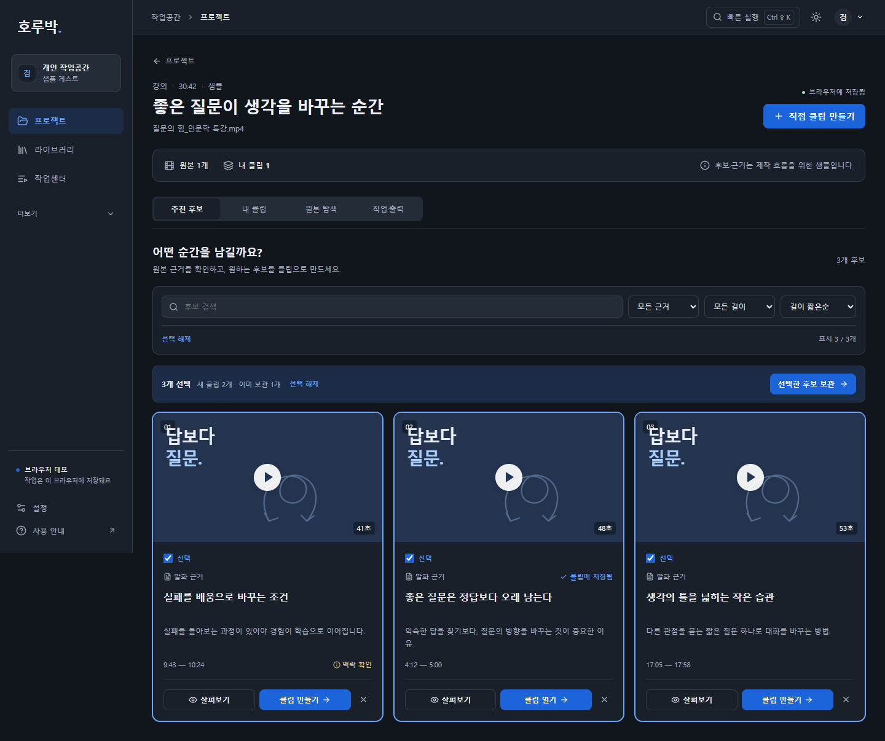
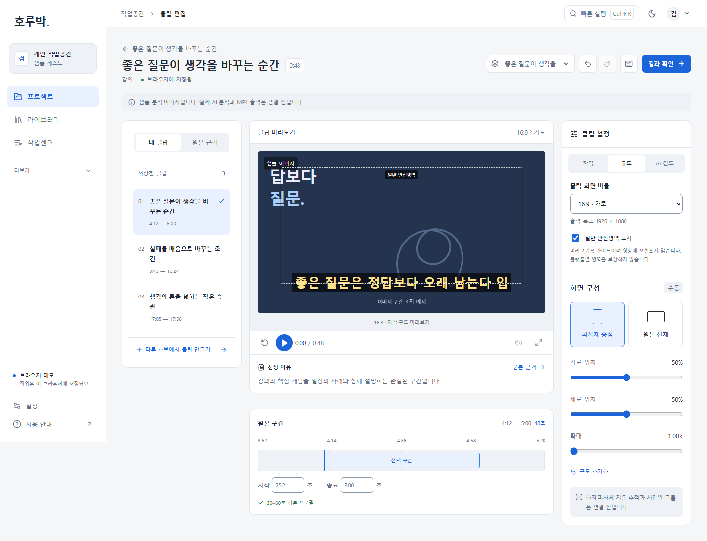

# OpusClip 영상 분석 후 기능 보완 검수

기준일: 2026-11-06. [분석·Council 판정](opus-walkthrough-council-review.md)을 바탕으로 호루박 데스크톱 UI에 세 기능군을 구현했다.

## 구현 결과

| 기능 | 동작과 완료 범위 |
|---|---|
| 후보 탐색·일괄 보관 | 제목/요약/선정 근거 검색, 근거 유형·45초 경계 길이 필터, 원본 시간·길이 정렬. 보이는 후보 선택, 선택/신규/기존 수 표시, 중복 없는 보관 후 내 클립 이동 |
| 네 화면비·일반 가이드 | 9:16·1:1·16:9·4:5의 실제 프레임과 결과·JSON 목표 치수 일치. 기존 기록은9:16. 안전영역은 미리보기 참고선이며 출력 JSON에서 제외 |
| undo/redo·단축키 | 프로젝트·클립별 최대20개 메모리 이력. 새 편집 시 redo 제거. 입력창·IME·대화상자 보호, 단축키 도움말 |

기존 단일 채택·숨김/복구·맥락 보정·원본 재연결·다운로드를 유지한다. 백엔드·인증·AI·렌더·외부 게시는 이번에 구현하지 않았다. 후보 검색과 일괄 보관은 영상의 후보 검토 흐름에서 확장한 호루박 자체 개선이며, 영상에서 해당 검색·배치 UI가 직접 관찰됐다고 주장하지 않는다.

## 실행 결과

- 단위 시험: **62/62**. 기존38개 및 후보 탐색6개·히스토리4개·출력 프로필14개.
- TypeScript·Vite 프로덕션 빌드: 통과.
- 기존 기능 회귀: **14/14**, 브라우저 실행 오류0. 저장·복원·맥락 보정/undo·JSON/SRT·클립 관리·일반 영상·URL·실제 로컬 영상 재생/재연결·브랜드 프리셋·백업 등.
- 새 기능 검증: **7/7**, 브라우저 실행 오류0. 상세 항목은 아래와 같다.
- 변경 화면 행렬: **30개 조합 통과**. 1280×800·1440×900·1920×1080 × 라이트/다크 × 후보 선택 화면 및 편집기4비율. 실제 테마·프레임 비율·가로 넘침을 검사했다. 편집기에서 화면 안에 보이는 필수 조작의 가로 이탈도 없었다.

| 새 기능 시나리오 | 확인 |
|---|---|
| 후보 필터·빈 결과 | 필터 변경 시 선택/작업 바 제거와 안내, 검색·유형의 빈 결과 복구, 길이 정렬 |
| 중복 없는 일괄 보관 | 기존1개에 신규2개만 추가, 재보관해도3개 유지, 기존 편집 불변, 새로고침 복원 |
| 화면비·JSON | 네 프레임 비율과 각각의 목표 치수 일치, rendered:false 유지, showSafeArea 출력 JSON 제외 |
| 이력 분기 | undo→redo 정확 복원, 새 변경 후 redo 비활성화, 가이드 설정도 복구 |
| 키보드·입력·대화상자 | Ctrl+Z/Shift+Z/Y, 대화상자에서 이력 유지, 문구 입력의 native undo가 화면비 이력을 되돌리지 않음 |
| 클립 격리·복원 | 다른 클립으로 이력 전파 없음, 돌아온 클립 redo, 새로고침 후 비율 보존 |
| 데스크톱 배치 | 위30개 화면 조합, 라이트/다크와 네 실제 프레임 검사 |

시험은 사용자 브라우저와 분리된 Chrome 환경에서 실행했다. 초기 배치 시험이 탭 URL 변경 직후 DOM을 읽어 일시적으로0행으로 판정한 점을 수정하고 전체7건을 재실행했다. 이는 시험의 대기 조건 수정이며 중복 보관 제품 결함으로 기록하지 않는다.

실행 자료: [새 기능·배치 JSON](opus-feature-qa.json) · [기존 기능 회귀 JSON](opus-regression-qa.json).

## 시각 검토

루트가 실제 앱과 캡처를 확인했고, 별도 에이전트가 아래 편집기1440px 라이트/다크 정적 화면을 새 시각으로 검토했다. 확인한 범위에서 중요한 조작 잘림·가로 이탈·출력 비율 문구 불일치는 없었다. 후보 화면은 그 화면 작성자가 검토했으므로 독립 검수로 부풀리지 않는다.

추가 증거: [세로·다크 편집기](screenshots/opus/editor-9x16-dark-1440.png).

## 한계와 후속

- 모바일 화면은 구현·검수하지 않았다.
- 일반 참고선은 자막 위치를 자동 보정하거나 플랫폼별 UI 침범을 판정하지 않는다. 기존 자막 일부가 참고선 밖일 수 있다. 자막 위치·cue 편집은 후속이다.
- 전체 선택 때 두 위치에서 선택 해제가 가능하다. 작업 맥락은 명확하지만 후속 사용성 검토에서 중복 조작을 줄일 수 있다.
- 새 비율별 프레임 측정·다운로드 검사는 샘플을 대상으로 했다. 실제 로컬 영상 재생/재연결은 기존 회귀 시험에서 확인했으며 모든 파일·코덱·비율 조합을 전수 검사하지 않았다.
- 샘플 후보3개로 후보 수십 개의 실제 검색 효율을 보장하지 않는다. 모델 생성·정확도·처리 비용·품질도 이번 시험 대상이 아니다.
- 새로고침 후 편집 상태는 보존하지만 undo/redo 메모리 이력은 초기화된다.
- 과거 v3 기본 화면96개 기록은 보존했다. 이번에는 변경 화면30개를 검사했으며96개 전체 재검사로 보고하지 않는다.
- 외부 편집 XML, 다중 길이·다중 구간, 자막 cue·어절 컷, 시간별 크롭, 재사용 브랜드, B-roll·음성 훅, 게시·예약·팀 기능은 분석 문서의 후속 우선순위를 따른다.

이번 변경은 로컬 작업이며 자동 커밋·GitHub 푸시는 하지 않았다.
