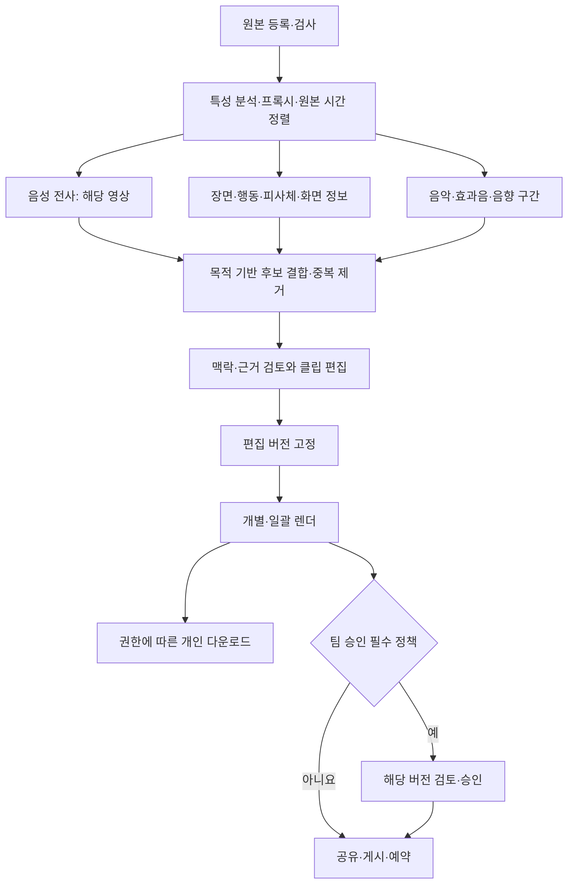

# 호루박 제품·계획서·UI/UX 개편안 v3

- 공식 프로젝트명: **AI 결합 영상물 하이라이트 숏폼 자동 제작 시스템**
- 서비스명: **호루박**
- 작성일: 2026-11-05 KST
- 상태: **전체 기능 설계의 개편 초안**. 현재 앱 구현·AI 성능·배포 완료를 뜻하지 않는다.
- 최신 사용자 결정: 기존 기능 유지·보완, 경쟁사 수준 전체 기능 설계, 모든 분야 영상물 지원, Agency Agents 적용.
- 이번 산출물은 제품 범위·변경 구조·정보구조·구현 차수를 정리한다. 화면별 상세 명세·확정 API·일정 산정은 후속 설계 산출물로 구체화한다.

## 1. 목표와 범위 변경

> 다양한 분야의 영상에서 장면·행동·피사체·음성·음악·효과음·화면 정보를 분석해 하이라이트를 추천하고, 원본 근거와 맥락을 검토하며 여러 클립을 편집·출력·배포하는 웹 제작 시스템.

강의·연설·팟캐스트에 한정하지 않는다. 브이로그·스포츠·게임·제품·공연·여행·동물·화면 녹화 등 분야를 입력 분류로 제한하지 않으며, 혼합 콘텐츠도 단일 장르로 강제하지 않는다. 기존 세 장르는 지원 사례이자 기능 회귀 검증 사례로 남긴다.

**전체 목표와 구현 차수는 구별한다.** 게시·협업·브랜드·사용량 관리 등을 전체 설계에 포함하며, 구현은 의존성에 따라 나눈다. 전체 설계를 캡스톤 최소 범위로 축소하지 않는다.

“모든 분야”는 콘텐츠 대상의 확대다. 파일 형식·코덱·길이·해상도·비공개/DRM 접근·처리 자원 한도는 별도 지원 조건으로 정의한다. 모든 영상에서 같은 자동 분석 품질이 확보됐다는 성과 문구로 사용하지 않는다.

OpusClip은 비대화 영상의 시각·음향 신호 기반 클리핑과 피사체 추적을 안내한다. 이는 멀티모달 구조를 검토하는 참고 근거이며, 호루박의 품질이나 실제 상대 성능을 증명하지 않는다. [ClipAnything](https://www.opus.pro/clipanything), [AI Reframe](https://www.opus.pro/ai-reframe)

## 2. 유지·변경·추가의 구분

| 구분 | 내용 |
|---|---|
| 유지 | 원본 등록, STT, 추천 근거, 맥락 비교·적용·되돌리기, 자막, 화자/얼굴, OCR 자료 보존, 자연어 편집, 저장·출력·권한의 기존 기능 목표 |
| UI 유지 | 서비스명·블루 테마·라이트/다크, 검색·즐겨찾기·보기 전환·이름 변경·삭제 확인, 원본 재연결, 키보드, 샘플/실제 구분 |
| 구조 변경 | 고정 3장르 → 콘텐츠 특성·목적, 전사 필수 → 멀티모달 분석, 프로젝트당 편집 한 개 → 독립 클립 여러 개 |
| 기능 보완 | 실제 분석·권한·저장·렌더, 어절 시간, 자막 cue, 실제 트림, 시간별 크롭, undo/redo, 충돌·실패·복구 |
| 신규 확장 | 브랜드·소재·템플릿, 다중 비율·일괄 출력, 공유·검토·승인, 게시·예약, 협업, 사용량·플랜·결제, API·운영·성과 |
| 별도 제품 모드 | 아바타·음성 복제·신규 영상 생성. 입력 영상을 편집하는 기능과 구별해 제공 조건·데이터·비용을 설계 |

현재 코드에 실제 인증·AI·렌더가 없는 점과 계획서에 해당 기능이 없는 점을 혼동하지 않는다. 현재 상태의 근거는 [경쟁 분석 보고서](competitor-analysis-2026-11-05.md)에 정리돼 있다. 다른 팀원 저장소의 구현 상태는 미확인이다.

## 3. 계획서에서 개정할 내용

| 계획서 부분 | 개정 내용 |
|---|---|
| 표지·요약·프로젝트명 | 새 공식명 적용. 모든 분야 영상의 멀티모달 하이라이트 제작·배포 목표 |
| 배경·대상·제공 가치 | 음성 콘텐츠 외 행동·장면·피사체·음향 기반 사용 과제 추가 |
| 개발 범위 | 기존 기능 보존 + 경쟁사 공통 제작/관리/배포 기능 + 별도 생성형 모드 구분 |
| 입력·출력 | 장르 제한 삭제. 제작 목적·관심 대상·자동 특성, 기본/확장 출력 프로필 구분 |
| 시스템 구성 | 선택적 음성 경로와 시각·음향 분석, 다중 클립, 버전·출력·게시 작업 추가 |
| 요구사항 세부 계획 | 기존 ID의 정의 변경과 보완을 기록하고 신규 확장 ID 연결 |
| UI·시나리오 | 무음·액션·화면 녹화·혼합 영상, 다중 클립·팀 검토·예약까지 추가 |
| 역할·일정·비율 | 사용자 최종 일정표를 기존 기준으로 보존. 추가 범위는 별도 규모·담당·일정 산정 |
| 평가 | 기존 평가 계획을 회귀 부분집합으로 유지하고 멀티모달 평가 행렬 추가 |
| 리스크·운영 | 비용·품질 한계, 연동 권한·실패 복구, 버전 승인·중복 게시·데이터 수명 추가 |

원본 HWPX는 보존한다. 최종 일정표 이미지는 원본 표보다 우선하며 SFR-004 날짜는 **2026-11-05**로 정정한 기준을 유지한다. 과거 예정일을 구현 완료로 표시하지 않는다.

기존 100% 비율은 기존 범위의 기준이다. 새 기능을 추가한 전체 작업량에도 그대로 적용하지 않는다. 새 범위의 담당·일정·비율은 **미확정**으로 기록한 뒤 재산정한다.

## 4. 기존 요구사항의 개정 방향

기존 ID는 추적성을 위해 보존한다. 아래 명칭은 개정 제안이며 기존 요구사항을 이행한 결과가 아니다.

| 기존 ID | 개정 방향 | 유지할 내용 / 확장할 내용 |
|---|---|---|
| SFR-001 | 영상 입력·콘텐츠 특성 등록 | 파일/지원 URL 유지, 장르 강제 삭제·목적/관심 대상·자동 특성 |
| SFR-002 | 미디어 전처리·멀티모달 비동기 작업 | 프록시/큐·취소 유지, 분석 경로 선택·부분 결과·재사용 |
| SFR-003 | 선택적 음성 전사·어절 정렬 | 한국어 STT 유지, 음성 없음/미지원/실패 구별·교정·다국어 연결 |
| SFR-004 | 목적 기반 멀티모달 후보 추천 | 장르별 규칙은 프리셋으로 유지, 장면·행동·음향·혼합 후보/중복 제거 |
| SFR-005 | 영상 맥락 손실 검토·구간 보정 | 발언 조건·부정·질문 유지, 행동 전후·사건 순서·장면/음악 경계 검토 |
| SFR-006 | 자막 cue·강조·스타일 편집 | 한글 가독성 유지, 큐 교정·번역·브랜드·출력 동기화 |
| SFR-007 | 화자·얼굴·피사체 추적·구도 | 기존 얼굴/화자 유지, 인물 없는 영상의 대상·행동 영역과 시간별 수동 보정 |
| SFR-008 | 핵심 화면 정보 보존 레이아웃 | 슬라이드/판서 유지, 제품 글자·스코어·UI·핵심 영역 보존 |
| SFR-009 | 근거 기반 자연어 재편집 | 기존 6종 명령·검증 유지, 장면/피사체/음향 근거 참조와 모호성 확인 |
| SFR-010 | 클립 편집·멀티모달 미리보기 | 기존 편집 기능 보존, 다중 클립·트림·전사/장면/소리 탐색 |
| SFR-011 | 버전별·다중 프로필 렌더·출력 | 기존 9:16 MP4/SRT 유지, 다른 비율·일괄 출력·부분 실패 |
| SFR-012 | 원본·다중 클립·버전·산출물 이력 | 기존 저장/삭제 유지, 독립 클립·승인 버전·원본 교체 영향 관리 |
| PER-001 | 전체 제작·게시 작업의 성능·신뢰성 | 단계 시간/실패/재시도 유지, 모달리티별 비용·대기·출력·배포 측정 |
| PER-002 | 편집 응답·연산 자원 효율 | 프록시/캐시 유지, 장면 샘플링·탐색·부분 재분석·프레임 예산 |
| SIR-001 | 사용자·프로젝트·작업공간 권한 | 서버 접근 검사 유지, 협업 역할·공유·승인·다운로드 권한 확장 |
| SIR-002 | 외부 입력·명령·연동 응답 검증 | 파일/URL/명령 검증 유지, 미디어 자산·외부 연결·웹훅 검증 |

**책임:** 권준한의 SFR-003·004·005·007·SIR-001 및 전체 웹 UI는 기존 사용자 지시를 기준으로 한다. 입력·큐·자막 합성·OCR·자연어 해석·저장·렌더는 팀 기능과 연결한다. SFR-010의 원래 담당 표와 전체 웹 UI 책임을 혼용하지 않도록 화면 구현·편집 기능·서버 연동 책임을 분리해 팀 표를 개정한다. 신규 서버 기능을 권준한 담당으로 자동 배정하지 않는다.

## 5. 전체 기능 지도와 확장 ID

EXT는 이번 초안의 추적용 ID다. 최종 요구사항 번호를 확정할 때 기존 ID와 대응표를 남긴다. 전체 목표에 포함하되 구현 차수·제공 조건은 서로 다르다.

| ID | 기능군 | 핵심 기능·설계 범위 | 주요 연결 |
|---|---|---|---|
| EXT-001 | 콘텐츠 특성·목적 | 음성/음악/행동/화면 정보/장면/피사체 혼합 프로필, 사용자 보정 | SFR-001/002/004 |
| EXT-002 | 시각 하이라이트 | 샷·장면·행동/이벤트 구간, 프레임·장면 근거, 무음 후보 | SFR-004/005 |
| EXT-003 | 음향 하이라이트 | 음악·효과음·환경음 구간과 경계, 시각/음성 근거 결합 | SFR-002/004/005 |
| EXT-004 | 다중 클립 | 채택/거절/복구, 수동 생성, 복제·이름·태그·검색 | SFR-010/012 |
| EXT-005 | 추천 탐색·재추천 | 목적/길이/관심 대상·프롬프트 탐색, 중복·근거·사용자 피드백 | SFR-004 |
| EXT-006 | 정밀 편집 | 트림·분할·재배열·비연속 구간·텍스트 기반 컷·무음/군더더기 검토·undo/redo | SFR-003/010/012 |
| EXT-007 | 자막·번역 | 시간별 cue·교정·줄바꿈·강조·번역·언어별 파일 | SFR-003/006/011 |
| EXT-008 | 피사체·장면 구도 | 얼굴 외 대상 추적·수동 대상 지정·시간별 크롭·다양한 비율 | SFR-007/008 |
| EXT-009 | 브랜드·템플릿 | 글꼴·색·로고·자막·인트로/아웃트로·팀 기본값 | SFR-006/010/012 |
| EXT-010 | 미디어 라이브러리 | 원본·소재·음악·B-roll·권리/출처·재사용·보관 | SFR-001/010/012 |
| EXT-011 | 음성·음향 보정 | 잡음·음량·음악/음성 균형, 원본 비교·복구 | SFR-002/010/011 |
| EXT-012 | 출력·외부 편집 연계 | 비율/해상도/자막 프로필, 일괄 출력·부분 재시도·교환 형식 | SFR-011/012 |
| EXT-013 | 공유·검토·승인 | 만료/회수 가능한 검토 링크·댓글·수정 요청·버전 승인 | SIR-001/SFR-012 |
| EXT-014 | 게시·예약 | 채널 계정 연결·메타데이터·시차·예약·실패 복구·중복 방지 | 신규 배포 작업 |
| EXT-015 | 협업 | 작업공간·초대·역할·프로젝트 공유·감사 이력 | SIR-001/SFR-012 |
| EXT-016 | 사용량·플랜·결제 | 예상 소모·한도·예약/정산·실패 반환·청구·플랜 | 신규 운영 기능 |
| EXT-017 | 성과·제작 효율 | 완주/채택/수정 시간/원가와 외부 채널 성과를 별도 관리 | 게시 연동·계측 |
| EXT-018 | API·웹훅·자동화 | 입력/작업/결과·이벤트·서명·재전송·호출 제한 | API/운영 계약 |
| EXT-019 | 원본·분석·편집 버전 | 교체·재분석 영향·클립 독립 저장·동시 수정 충돌·복원 | SFR-012 |
| EXT-020 | 운영·지원·관리자 | 작업/비용/오류·문의·정책·삭제/보관·보안·사용자 관리 | PER/SIR |
| EXT-021 | 외부 입력 연결 | 공급자별 허용 입력·동기화·반복 작업·인증 만료 복구 | SFR-001/002 |
| EXT-022 | 생성형 보조/별도 모드 | 생성 B-roll·아바타·음성 복제·신규 영상 생성의 별도 진입·동의·출처·비용 | 별도 제품 경계 |

다른 제품·플랜에 흩어진 경쟁사 기능을 모두 한 플랜의 보장 기능으로 소개하지 않는다. 이 표는 호루박의 목표 기능 설계다. 실제 제공사/플랫폼 지원 범위·허용 경로·언어·출력 품질·가격은 상세 설계에서 확인한다. 외부 게시의 모든 플랫폼 지원을 먼저 약속하지 않는다.

## 6. 분석·시스템 구조

- 음성·인물이 없는 영상도 정상 입력이다. 전사/화자 경로는 적용 안 함이 가능하다.
- 후보의 중요도는 소리 크기·움직임·장면 전환만으로 확정하지 않는다. 목적·전후 맥락·복수 근거·사용자 검토를 결합한다.
- 시각 근거로 확인되지 않는 인과·득점·제품 성능 등을 만들어 설명하지 않는다.
- 원본 시간과 검출 구간은 동일 기준으로 정렬한다. 장면 샘플링으로 놓치는 짧은 사건과 연산 비용을 함께 평가한다.
- 기존 React/TypeScript·Spring 인증/API·Python 분석·비동기 워커의 역할 분리는 유지한다. 모델·도구 추가는 표본 시험 후 결정하며 이번 문서에서 특정 모델 성능을 보장하지 않는다.
- 분석 결과는 모달리티별 완료·적용 안 함·미지원·실패·불확실을 구분한다. 필요한 근거가 부족하면 이유와 수동 편집 경로를 제공한다.
- 정책·자원 한도, 접근 권한, 입력 검증, 요청 버전 고정과 중복 방지는 처리 전체에 적용한다.

### 부분 결과의 사용 규칙

다음은 서버 연결 후 적용할 기능 가용성 계약이다. 분석이 일부 실패했다고 원본과 정상 결과를 삭제하거나 샘플 성공으로 대체하지 않는다. 출력은 실제 원본 확보·유효 편집·렌더 지원·권한을 별도로 만족해야 한다.

| 분석 결과 | 후보·근거 | 편집·출력 허용 | 사용자 표시 |
|---|---|---|---|
| 음성 없음 + 시각 성공 | 시각/장면 후보 사용, STT 적용 안 함 | 정상 편집·출력 | 음성 없음은 실패로 표시하지 않음 |
| STT 실패 + 시각 성공 | 시각 근거 후보 사용, 실패한 전사/의미 판단은 사용하지 않음 | 원본 음성 확인·수동 자막 등 보완 후 편집·출력 | 부분 결과, 음성 관련 맥락 미검토 명시 |
| 시각 분석 실패 + STT 성공 | 발화 근거 후보 사용, 자동 피사체/화면 보존 미확인 | 전체 화면·수동 구도 보완 후 편집·출력 | 실패 기능과 가능한 수동 행동 표시 |
| 자동 분석 전체 실패 | 자동 추천 없음. 기존 편집은 보존 | 원본이 유효하면 수동 구간·자막·구도로 편집·출력 가능 | 분석 실패, 수동 제작/재시도 제공 |
| 입력 검사·디코딩 실패 | 신규 분석/후보 생성 불가 | 해당 원본의 출력 차단, 원본 교체·재업로드 | 입력 실패 이유와 복구 행동 |

불확실한 결과는 근거·미해결 위험을 표시하고 확정 사실로 승격하지 않는다. 사용 가능한 결과가 있다는 사실을 모든 분석 성공으로 표시하지 않는다. 입력 유효성·분석별 상태·기능 가용성·렌더 상태를 분리한다.

## 7. 데이터와 API의 중심 개념

| 개념 | 책임 |
|---|---|
| Workspace / Membership | 사용자·역할·공유·사용량 정책 |
| Project / MediaAsset / InputRevision | 원본·제목·태그·콘텐츠 특성·입력 버전과 보관 |
| AnalysisRun / TranscriptRevision | 분석 경로·설정/모델 버전·발화·어절·장면·음향·트랙 결과 |
| EvidenceRef | 발화/어절/프레임/장면/이벤트/음향 등 유형별 원본 근거 |
| Candidate | 원본 구간·목적·선정 이유·근거·중복/위험·채택 상태 |
| Clip / EditRevision | 독립 클립·구간 목록·자막 cue·소재·크롭/레이아웃 경로 |
| Review / Approval | 어떤 편집 버전의 검토·댓글·승인인지 |
| Job / RenderArtifact | 입력·분석·편집 버전, 처리 상태·실패·검사된 영상/자막 |
| PublishJob / ChannelConnection | 출력 버전·채널·예약 시각·권한·외부 결과와 중복 방지 |
| UsageLedger | 예상/예약/실소모/반환, 작업·사용자·워크스페이스와 연결 |

전사 교정, 표시 자막 수정, 텍스트를 삭제해 영상 구간을 자르는 동작은 구분한다. 비연속 편집은 순서 있는 원본 구간→출력 시간 매핑으로 자막·음성·크롭을 함께 계산한다.

저장·렌더·승인·게시가 참조하는 버전을 고정한다. 편집 후 과거 승인/출력/게시 예약을 어떻게 유지·갱신할지 명시하고 사용자 확인 없이 새 파일로 교체하지 않는다. 늦은 분석 결과가 최신 편집을 덮지 않게 한다.

개인 작업은 승인 없이 편집·렌더·다운로드할 수 있는 기본 흐름을 유지한다. 팀의 검토 필수 정책을 켜면 외부 공유·게시·예약에 해당 버전의 승인을 요구한다. 내부 검토용 렌더는 먼저 만들 수 있으며, 역할별 다운로드 권한은 별도 검사한다. 새 편집 버전은 과거 승인을 자동 승계하지 않는다.

API는 화면 자료형과 분리한다. 기존 Gateway에 호환 어댑터를 두고 클립별 저장·분석 근거·모달리티 결과·버전·출력 작업 계약으로 확장한다. 현재 interface가 실제 HTTP 구현이라는 뜻은 아니다.

## 8. UI/UX 정보구조

| 계층 | 화면 | 주요 내용 |
|---|---|---|
| 기본 탐색 | 프로젝트 | 최근/즐겨찾기·검색·목적/특성/상태·새 영상 |
| 기본 탐색 | 라이브러리 | 원본·소재·음악·브랜드·템플릿 |
| 기본 탐색 | 작업센터 | 분석·개별/일괄 렌더·실패·결과 |
| 작업공간 더보기 | 게시·예약 | 채널·문구·출력 버전·달력·실패 복구 |
| 작업공간 더보기 | 팀·검토 | 초대·역할·댓글·수정 요청·승인 |
| 작업공간 더보기 | 성과 | 제작 효율·외부 게시 성과를 구분 |
| 작업공간 설정 | 계정·연결·사용량/결제·API/웹훅·권한/보관 | 기능별 전체 화면·권한·빈/미연결/실패 상태 |
| 별도 모드 | 생성형 제작 | 입력 영상 편집과 구별되는 진입·제공 범위·사용량 |

프로젝트 내부는 **추천 후보 / 내 클립 / 원본 탐색 / 작업·출력**으로 구성한다.

- 등록: 장르를 강제하지 않고 제작 목적·관심 대상을 받는다. 자동 분석한 특성을 사용자가 확인·보정한다.
- 후보: 구간·선정 이유·근거 유형·미해결 위험·미리보기→클립 만들기. 채택/거절/복구·다중 채택.
- 내 클립: 각기 편집·복제·이름·태그·출력 상태·다중 선택. 후보 선택이 기존 클립을 덮지 않는다.
- 원본 탐색: 발화 / 장면·이벤트 / 소리 / 화면 정보. 사용 가능한 근거를 원본 위치에서 확인한다.
- 편집: 기존 좌측 탐색·중앙 프리뷰/타임라인·우측 도구 유지. 자막/구도/AI/소재를 전환하고 상시 열을 늘리지 않는다.
- AI: 맥락·자연어·화면 보존을 적용 조건에 맞게 사용한다. 근거 비교→변경 미리보기→적용/취소/되돌리기.
- 구도: 화자/피사체/원본 전체/자료·화면/분할과 구간별 수동 보정.
- 검토: 특정 버전에 댓글·승인. 수정본은 재검토 필요 여부를 표시한다.
- 출력/게시: 실제 산출물과 버전을 확인하고 일괄 작업은 실패 항목만 복구한다.
- 음성 없음은 정상 상태다. 빈 전사 오류로 끝내지 않고 장면 탐색·수동 자막/클립으로 연결한다.

### 시각·상호작용 계약

Emil 기준을 공통 적용한다. 중립 블루·라이트/다크·기존 시각 토큰을 유지하고 메뉴가 늘어도 기본 화면의 제작 행동을 중심에 둔다.

| Before | After | Why |
|---|---|---|
| 기능별 상시 패널·안내 추가 | 작업공간·프로젝트·편집 도구의 계층 분리 | 전체 기능을 담으며 화면 밀도 관리 |
| 고정 3장르 필수 | 목적·콘텐츠 특성·관심 대상 | 분야 제한 제거 |
| 전사·화자 중심 | 장면/이벤트/소리/피사체 근거 전환 | 비음성 영상도 정상 탐색 |
| 후보 선택이 편집값 교체 | 미리보기 뒤 독립 클립 생성 | 기존 편집 보존 |
| 편집/승인/출력/게시의 단일 완료 | 각 상태와 버전을 구분 | 사용자가 무엇이 끝났는지 판단 |
| 모의 진행·샘플 점수 | 실제 가용 결과·짧은 근거·실패 복구 | 화면과 실제 처리 일치 |

기존 216px 사이드바·56px 상단, 24px 여백·16px 간격, 본문 14/22px·제목 24/32px, 입력 44px·버튼 40px를 기준으로 상세 배치를 검증한다. 편집 260px/중앙 최소400px/280px 구조는 콘텐츠·텍스트 확대로 다시 시험한다.

검색·탭·키보드·재생 조작은 즉시 반응한다. 포인터 누름120ms·간헐적 메뉴/대화상자160ms, reduced-motion에서 이동 제거 기준을 유지한다. 기능 확장이 장식 애니메이션 확대를 뜻하지 않는다.

기존 **1280px 이상 데스크톱 범위**를 유지한다. 모바일 전용 UI는 별도 설계 결정 사항이다. 모든 분야 영상 지원이 모바일 UI 지원을 자동 확정하는 것은 아니다.

## 9. 기존 데이터·기능 보존 방법

1. 새 저장 형식의 schemaVersion과 검증·백업·되돌림 경로를 정의한다.
2. 기존 Project.edit는 기본 클립·첫 편집 버전으로 이전한다. 변환 실패 시 원본 자료를 삭제하지 않는다.
3. 기존 장르값은 레거시 태그/프리셋으로 보존하고 신규 등록·처리의 필수 enum에서 제거한다.
4. 단일 자막은 기존 표시 레이어로 보존한다. 실제 발화 cue로 임의 변환하지 않는다.
5. 수동 cropX/Y/scale은 기존 미리보기 값으로 보존하며 검출된 피사체 좌표로 취급하지 않는다.
6. 기존 completed는 렌더 성공·승인·게시 완료로 승격하지 않는다.
7. 원본 재연결·검색/즐겨찾기·편집·스타일·맥락 적용·undo의 회귀 항목을 정한다.
8. 로컬 데모 계정을 서버 계정이나 권한 증거로 승격하지 않는다. 실제 로그인과 분리한다.
9. 기존 화면 경로·저장 키는 호환 어댑터/이전 정책으로 다룬다. 단순 키 변경으로 새 빈 서비스처럼 보이게 하지 않는다.
10. 현재 loadProjects()의 고정 3장르 검증과 전체 샘플 대체 동작을 개정한다. 한 항목이 새 스키마/미지원 값이어도 전체 목록을 샘플로 바꾸지 않고 항목별 복구·원본 보존을 제공한다.
11. 이전을 같은 원본 데이터로 반복 실행해도 클립·편집 버전이 중복 생성되지 않도록 안정된 대응 키를 둔다. 변환 결과 검증이 끝난 뒤 새 저장을 확정하고, 중단·실패 시 기존 자료와 복구 지점을 유지한다.

## 10. 구현 차수와 통과 조건

차수는 전체 목표를 나누는 실행 순서다. 달력 날짜·소요 기간·팀 배분은 아직 확정하지 않았다.

| 차수 | 목표 | 통과 조건 |
|---|---|---|
| 0 전체 설계 | PRD·요구사항 추적·화면·상태·데이터/API·검증 계획 | 전체 기능의 화면/데이터/책임/상태/증거 대응 |
| 1 기반·실제 완주 | 호환 이전·인증·입력·분석 경로·저장·출력 | 음성 있는 원본과 음성 없는 원본에서 실제 클립 완주·권한·복구 |
| 2 분석·정밀 편집 | 멀티모달 추천·맥락·피사체·화면 보존·자연어·다중 클립 | 근거 검토·수정·출력 버전 일치, 클립 간 독립 보존 |
| 3 반복 제작 | 브랜드·소재·다중 비율·일괄 렌더·검토 공유 | 기본값 재사용·부분 실패 복구·승인 버전 보존 |
| 4 배포·협업·운영 | 게시예약·권한·사용량결제·성과·API/지원 | 중복 게시 방지·연동 만료·권한·한도/실패 소모 검증 |
| 5 부가·생성형 확장 | 고급 미디어·생성형 모드·추가 연동 | 기능별 효용·비용·출처·권한·제공 조건 충족 |

같은 차수의 병행 작업은 가능하다. 개인 담당 모듈 품질 평가는 전체 서버 완성을 기다리지 않는다. 팀원 기능을 중복 구현하는 대신 동일 입력·버전의 샘플·실패 계약·통합 증거를 맞춘다.

## 11. 평가 계획의 개정

원계획에는 이미 **18개 원본 확보 목표(세 장르 각 개발3/최종3)**, 정렬 표본90·맥락 사례30, 평가자2명 이상·사용성5명 이상, 자연어6종×5 과제와 성능 목표가 있다. 이는 목표/계획이며 실제 자료 확보·실행 결과는 미확인이다.

이 계획은 기존 음성·자료 기능의 회귀 부분집합으로 유지한다. 전체 지원 평가는 다음 신호 조합을 포함하도록 확대한다. 새 표본 규모·목표치는 자료·장비·주석 비용을 보고 정한다.

| 평가 축 | 포함할 상황·지표 |
|---|---|
| 음성 | 있음/없음/혼합/겹침/잡음, CER·어절 시간·잘못된 전사 생성 |
| 시각 이벤트 | 정적/빠른 행동/짧은 사건/다중 장면, 후보 채택·누락·시각 근거 적절성 |
| 피사체 | 사람/사물/동물/화면 영역·없음/가림/컷, 대상 보존·오추적·흔들림 |
| 음향 | 음악/효과음/환경음/무음, 경계·이벤트 근거·불필요한 음향 편집 |
| 맥락 | 발언 한정/부정/질문, 행동 전후·사건 순서·장면/음악 완결성·허위 인과 |
| 화면 정보 | 자료/제품 글자/UI/점수 등, 핵심 영역 보존과 실제 가독성 |
| 사용자 효용 | 채택 클립 수·수정 시간·완주·반복 사용·경고의 추가 검토 부담 |
| 출력·운영 | 자막/음성/구도/시간 매핑·권한·충돌·재시도·중복·채택 클립당 비용 |

원본 단위 개발/최종 분리, 중복 영상 누수 방지, 가린 사람 평가·불일치 기록을 유지한다. 경고 지원 유무를 비교해 의미 손실 감소 없이 수정 부담만 늘어나는지 확인한다.

원계획의 RTF·지연·성공률 수치는 장비·기능 범위가 바뀐 뒤에도 실측 성과처럼 재사용하지 않는다. 모달리티별 비용·샘플링·연산량을 보고 목표를 재산정한다. “모든 분야”를 몇 개 사례의 성공으로 입증했다고 보고하지 않는다.

## 12. Agency Agents 적용과 다음 문서

이번 작업은 **제품 범위 → UX 구조 → 시각 계약 → 프론트엔드 실현 가능성 → 증거 기준**을 전달하는 방식으로 진행한다.

| 역할 | 이번 책임·인수인계 |
|---|---|
| Product Manager | 전체 기능 범위·개정 요구사항·차수·성과 가설 |
| UX Architect | 프로젝트/클립 관계·전역/프로젝트/편집 탐색·멀티모달 정상/실패 흐름 |
| UI Designer | Emil 공통 기준·계층/패널·주행동·상태별 시각/상호작용 계약 |
| Frontend Developer | 데이터/API 확장·이전·기능 회귀·실현 가능성 |
| Evidence Collector | 요구사항 대응·보존·미검증 구분·누락/충돌 점검 |

설치된 Agency 역할 정의를 사용한다. 이번 단계는 설계 검토이며 Frontend Developer가 앱을 구현했거나 Evidence Collector가 새 UI의 브라우저 테스트를 완료했다는 뜻은 아니다.

후속 상세 설계 산출물:
1. **제품 요구사항 명세 v3** — 모든 기능의 입력/결과·제공 조건·책임·완료 기준.
2. **기존·신규 요구사항 대응표** — 원 ID·EXT·화면·API·평가·구현 상태.
3. **UX/UI 설계명세 v3** — 전체 화면·흐름·와이어프레임·상태/오류·접근성.
4. **데이터·API·작업 계약 v3** — 스키마·시간/좌표·버전·권한·실패/취소·이벤트.
5. **구현·이전·검증 계획** — 팀 현황·규모 산정 후 차수/일정/분배 확정.

우선 고정할 설계는 **콘텐츠 특성·멀티모달 근거와 Project→Candidate→Clip→EditRevision→Render→Publish의 관계**다. 이 계약에 UI·작업·저장·검증이 연결되어야 한다.

## 13. 검토 상태와 미확정 항목

- PM·UX·UI 역할 검토와 최신 모든 분야 범위 반영: 초안에 통합.
- 프론트엔드 기술 검토: 고정 장르 검증·전체 샘플 대체 위험을 확인해 이전 조건에 반영했다. 타입/API·멀티모달 근거·독립 클립·시간/버전 계약을 통합했다.
- Evidence Collector 문서 검토: 기존 ID16개·확장22개·원계획 평가 목표·최신 범위를 확인했다. 부분 분석 결과의 가용성, 선택적 팀 승인, 반복 가능한 데이터 이전의 3개 보완 의견을 위 명세에 반영했다.
- 검증 한계: 문서·원문·코드 대조 검토다. v3 UI 구현·브라우저 과업·모델 품질·성능·서버 권한 시험은 수행하지 않았다.
- 미확정: 실제 팀 서버/API 진행, 시각/음향 모델·장치·원가, 플랫폼/결제 제공 조건, 새 범위의 담당·달력 일정·비율, 신규 평가 자료.
- 원본 HWPX와 기존 v2 문서는 과거 기준으로 보존했다. 이번 개편 초안이 기존 구현 완료 상태를 바꾸지 않는다.
- 기존 경쟁 분석 보고서는 개편 전 범위의 기록이다. 모든 분야 지원과 전체 기능 목표의 범위 정의는 이 v3 초안과 최신 사용자 지시를 우선한다.

